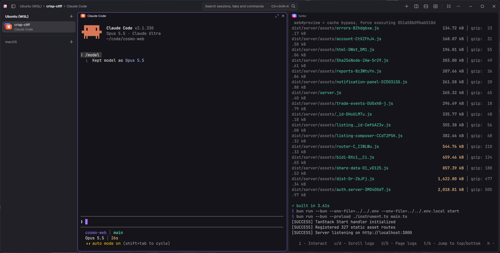

# Rexy

A small, fast, native Linux client for [Rex](https://www.superlogical.com/rex), built with Rust, egui and libghostty.



Every Rex server you use, with its sessions and tabs, in one window: a sidebar that tells you what each agent is doing, split panes, and a Ghostty terminal in each of them. Closing the window leaves your sessions running, and connecting never starts or installs a server.

Rexy is unofficial and not affiliated with Superlogical. It is early software for Linux, on Wayland and X11, and runs on Windows with Rex in WSL.

## Windows port

This is a port of [haydn-jones/rexy](https://github.com/haydn-jones/rexy) to Windows. On top of upstream it:

- **Needs WSL, with Rex's Linux server set up in it.** Rex does not run on Windows, so Rexy finds a WSL distribution running Rex and uses it as its home server. Other hosts are added from there as usual.
- **Can use the Rex.app icon from macOS.** Put it at `assets/windows/rex.png` before building and it becomes the window, taskbar, toast and installer icon. Without it, Rexy's own icon is used. The icon is not kept in this repository: see [assets/windows/NOTICE.md](assets/windows/NOTICE.md).
- **Adds New Session on *machine* to the command palette**, to start a session on a particular server rather than the one on show.
- **Draws a Windows 11 title bar of its own**: one row with where you are (server › session › pane), a search box in the middle, the tab and pane buttons, and Windows' minimise, maximise and close. Hovering maximise offers Windows' snap layouts.
- **Shows Mica behind the window** on Windows 11 22H2 and later, behind the title bar and sidebar. **Turn Off Mica Backdrop** in the command palette turns it off from the next launch.

Setup, building and what does not work yet on Windows are under [Windows](#windows) below.

## Features

- **Every server in one sidebar.** Your home server and every host it knows of, over a Unix socket, SSH or WebSocket.
- **Agent status at a glance.** Each tab shows its programs, a status dot and a line such as *Working* or *Needs approval*. An activity view gathers every pane that needs you, on every server, with how long it has waited.
- **Answer an agent without leaving your tab.** Peek at a pane that needs you: its terminal opens over the tab you are in and takes the keyboard, so you answer and carry on. The same key takes you to the next one, and closes the peek after the last. Coming back to the window, you are told what came to need you while you were away.
- **Notifications that take you there.** Click one to go to the pane that sent it.
- **Splits.** Split, resize and zoom panes, and move them between tabs.
- **Floating panes.** A scratch terminal over any tab: one key makes it, takes you to it, and from it puts it away, still running. Float any pane out of the layout and dock it again, and move and resize it with the mouse. They are Rex's own floating layers, so every client sees them.
- **A real terminal.** libghostty does the emulation: Kitty graphics, hyperlinks, search through the whole history, and your Ghostty theme and font.
- **Files and pictures reach the pane's machine.** Drop files on a pane, or paste a picture, and their paths are typed there. For a server on another machine they are sent to it first.
- **Rex's own keymap**, from your home server's `init.lua`, and a command palette, where the actions you write there ask their questions. They act on the session on show, whichever server it is on, and can call your other servers by name.

## Install

Rexy builds from source, with Rust 1.100 and Zig 0.17.x. Both are pinned for [mise](https://mise.jdx.dev/):

```sh
mise install
./scripts/icons    # optional: program icons
mise exec -- cargo build --release --locked
install -Dm755 target/release/rexy ~/.local/bin/rexy
```

Without mise, put Zig on `PATH` or point `ZIG` at it. A desktop entry and an icon to install are in `assets/`.

The program icons are Superlogical's and are not in this repository. See [assets/icons/NOTICE.md](assets/icons/NOTICE.md) before passing on a build that includes them.

## Usage

```sh
rexy                          # your Rex home, or else this machine's server
rexy --server ssh://studio    # or unix:///path, ws://, wss://, or a host name
```

The sidebar lists that server, then every host it knows of. **Add Remote Host…** in the command palette adds one, typed as `rex hosts add` takes it: `studio ssh://studio`. Right-click a server's name to change or remove it; a host declared in `init.lua` is changed there. A server that cannot be reached is retried, so the window can be opened before the server is up. `ssh://` needs `rex` on the other machine and an `ssh` that connects without prompting.

## Keys

These are the defaults, and `rex.bind` in your home server's `init.lua` changes them. The command palette lists every action with its keys.

| Keys | Action |
|---|---|
| **Ctrl Shift K** | Find a session, or a tab on any server |
| **Ctrl Shift A** | Go to the next pane that needs you |
| **Ctrl Shift Space** | Peek at the next pane that needs you |
| **Ctrl Shift P** | Command palette |
| **Ctrl Shift B** | Sidebar, or tabs along the top |
| **Ctrl Shift N**, **Ctrl Shift T** | New session, new tab |
| **Ctrl Tab**, **Ctrl Shift Tab** | Next and previous tab |
| **Alt 1** to **Alt 9** | Tab by its number; 9 is the last |
| **Ctrl Shift L** | Back to the tab shown before |
| **Ctrl Shift D**, **Ctrl Alt D** | Split the pane right or down |
| **Ctrl Alt** + arrow | Focus the pane on that side |
| **Ctrl Shift Enter** | Zoom the pane |
| **Ctrl Shift S** | Go to the floating panes, or from one put them away; with none, make one |
| **Ctrl Alt F** | Float the pane, or dock it |
| **Ctrl Shift W** | Close the pane |
| **Ctrl Shift C**, **Ctrl Shift V** | Copy and paste |
| **Ctrl Shift F** | Find in the pane |

With the mouse: drag the line between two panes to resize them, drag a pane's header onto a tab to move it there, drag a floating pane by its header to move it and by an edge or corner to resize it, click beside a server's or a session's name to fold it away, drag the bar at a pane's right edge to scroll through its history, double-click a name to rename it, and right-click anything for its menu. A pane's menu also clears it, and copies all its output. **Shift** overrides a program's mouse capture, and **Ctrl** with a click opens a link.

## Good to know

- **Your tab stays put.** The window shows the tab you chose, not the one another client or the `rex` CLI has the server show.
- **Panes fit the window that shows them.** Showing a tab takes its panes from any other client, which takes them back when it shows the tab.
- **Remote control is off by default.** `rex -C <client> do …` works only after you choose **Allow Remote Control** in the palette. With it on, any client of the server can type into a pane or close things.
- **Text is drawn as Ghostty draws it**, on whole pixels, in the `font-family` of your Ghostty configuration or else JetBrains Mono. Emoji and Nerd Font icons come from the fonts on your machine.
- **Programs cannot reach your machine.** They can copy to the clipboard but never read it, `file` links are never opened, and pictures are accepted only as pixels sent inline.
- **State** is kept in `rexy/state.json` under `$XDG_STATE_HOME` or `~/.local/state`.
- **Not yet:** moving a pane to another session, animated pictures.

Rexy speaks revisions 13 to 18 of Rex's control API, and refuses a server too old for the first of them.

## Windows

Rexy runs on Windows 11 x64 as a client for Rex in WSL, since Rex does not run on Windows itself. It needs WSL 2 with Rex installed in the default distribution, and `perl` there, which Ubuntu and Debian have.

- **Home** is the one Rex in WSL follows, as `rex hosts` has it. The default distribution is asked first, which starts it if it is stopped, then any other already running; no other is started to ask. `REX_HOME` and `--server` still come first.
- **`wsl://DISTRO[/SOCKET]`** reaches a server in a distribution, as in `wsl://Ubuntu`. Without a socket, that distribution's `rex` is asked where its server listens.
- **`ssh://` runs inside WSL:** `ssh` in home's distribution, or else the one whose Rex named home, or else the default one, forwards the server's socket there, so it needs keys and a config that work in WSL.
- **The window has no Windows frame.** Rexy draws its own title bar: drag it to move the window, double-click it to maximise, and drag any edge to size it. Snap, Win+arrow keys and snap layouts work as for any window.
- **Mica** is drawn through Direct3D 12 with DirectComposition. If it flickers on a variable-refresh display, turn it off from the command palette.
- **State** is kept in `%LOCALAPPDATA%\rexy`.

To install, run `rexy-<version>-setup.exe`. It installs for you alone, with no administrator, and puts Rexy in the Start menu under the name its notifications go by. The zip holds the same files, to unpack anywhere.

To build, you need Rust 1.100, Zig 0.17.1 and Visual Studio's C++ build tools with the Windows SDK; packaging also needs [Inno Setup 6](https://jrsoftware.org/isinfo.php):

```powershell
scripts\check.ps1      # formatting, lints, tests and a release build; -Fast skips the build
scripts\package.ps1    # dist\rexy-<version>-windows-x64.zip and dist\rexy-<version>-setup.exe
```

Both find Zig on `PATH`, where winget puts it, or in `ZIG`, and build in `C:\t\rexy` unless `CARGO_TARGET_DIR` says otherwise: Ghostty's build goes too deep for a longer path.

`rexy --help`, `--version` and `--probe` print to the terminal they were run from, but PowerShell does not wait for a windowed program, so its prompt can come back first. Pipe it, as in `rexy --probe | Out-Host`, to wait for it and its exit code.

Not yet on Windows: a notification clicked in the Action Center, once its toast has gone, does not reopen its pane. The window is drawn through Direct3D with wgpu, never OpenGL, which can leave it blank there.

## Development

Each live pane has its own Ghostty worker thread, so parsing never runs on the UI thread, and the UI draws the newest frame it has. The last sixteen tabs shown on each server stay streamed; any other is restored from a snapshot when shown.

`scripts/dev` runs `cargo` with the local Zig toolchain found for you:

```sh
./scripts/dev test --locked
./scripts/dev clippy --locked --all-targets -- -D warnings
./scripts/dev build --locked && python3 tests/smoke.py
```

`tests/smoke.py` starts its own disposable Rex server, Xvfb display and D-Bus session, and drives the real window. It needs `rex`, `Xvfb`, `dbus-run-session`, `xclip` and ImageMagick. `tests/live.rs` changes the server it is pointed at, so it refuses any that was not made for testing.

## Credits

Rex is made by [Superlogical](https://www.superlogical.com/rex). Terminal emulation is [Ghostty](https://ghostty.org)'s, through [libghostty-rs](https://github.com/Uzaaft/libghostty-rs), and the interface is [egui](https://github.com/emilk/egui). Parts of the terminal metadata handling are adapted from [rex-rune](https://github.com/shuv1337/rex-rune). The fonts are Inter and JetBrains Mono.

See [THIRD_PARTY.md](THIRD_PARTY.md) for licences and attribution.
